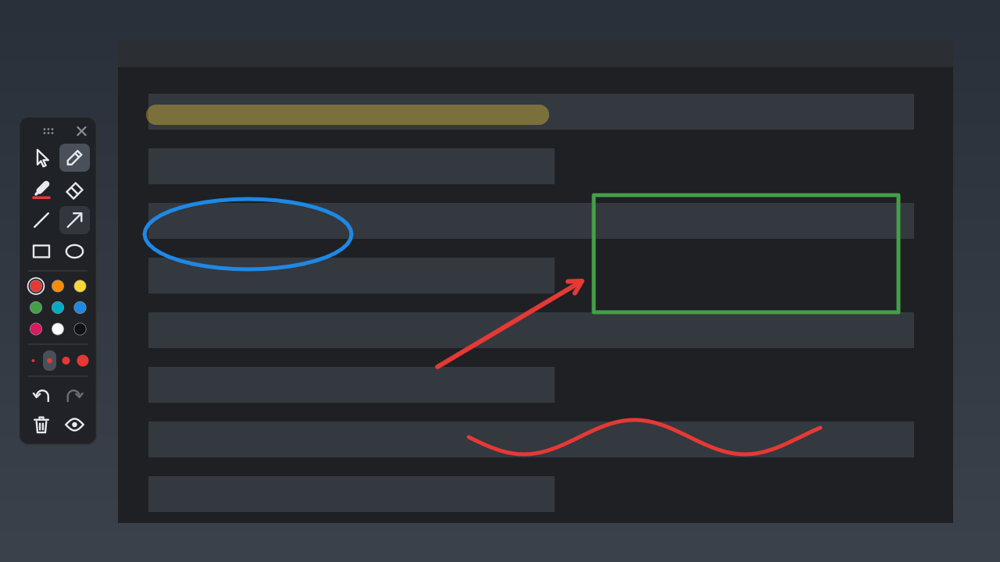
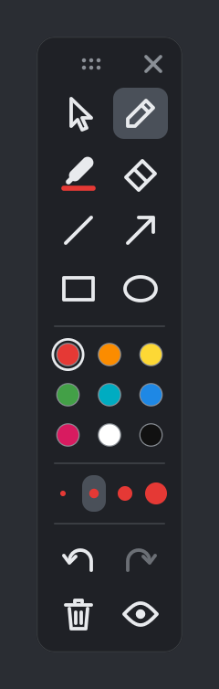

# Rabisco

Anote por cima de qualquer coisa na tela do Windows: um vídeo, um programa, uma chamada de vídeo. Funciona no estilo do Epic Pen, mas é grátis e de código aberto.



- **Leve:** um `.exe` de ~190 KB, sem instalador. Parado, ocupa ~2 MB de RAM.
- **Caneta de verdade:** usa a pressão da mesa digitalizadora, e a ponta de trás da caneta funciona como borracha.
- **Fora do caminho:** no modo mouse, o clique passa direto para o programa de baixo, e os desenhos continuam na tela.
- **Todos os monitores** ao mesmo tempo, com DPI diferente em cada um.

Feito em Rust puro com a API do Windows (`windows-sys`), sem framework de interface e sem navegador embutido.

## Como usar

Abra o `rabisco.exe`. A barra aparece na esquerda da tela.



| Parte da barra | O que faz |
|---|---|
| ⠿ e ✕ no topo | Arrastar a barra / fechar o Rabisco |
| Seta | **Modo mouse**: volta a clicar nos programas (os desenhos ficam) |
| Lápis | Caneta (sente a pressão) |
| Marca-texto | Traço grosso e transparente; não escurece onde passa duas vezes |
| Borracha | Apaga o traço inteiro em que você encostar |
| Linha, seta, retângulo, elipse | Formas. Segure **Shift** para travar em 45° ou deixar quadrado/círculo |
| Bolinhas coloridas | 9 cores |
| Pontos de tamanhos diferentes | Espessura (a roda do mouse em cima da barra ajusta fino) |
| Setas curvas | Desfazer / refazer |
| Lixeira | Apagar tudo (dá para desfazer) |
| Olho | Esconder / mostrar os desenhos |

Escolher uma ferramenta ou uma cor liga o modo desenho. Passe o mouse em cima de um botão para ver o nome e o atalho.

<br clear="right">

### Atalhos que funcionam em qualquer programa

| Atalho | Faz |
|---|---|
| `Ctrl+Shift+D` | Liga/desliga o modo desenho |
| `Ctrl+Shift+H` | Esconde/mostra os desenhos |
| `Ctrl+Shift+X` | Apaga tudo |
| `Ctrl+Shift+Q` | Fecha o Rabisco |

### Teclas no modo desenho

| Tecla | Faz |
|---|---|
| `P` `M` `E` | Caneta, marca-texto, borracha |
| `L` `A` `R` `O` | Linha, seta, retângulo, elipse |
| `1` a `9` | Cores |
| Roda do mouse, `+` `−` | Espessura |
| `Ctrl+Z` / `Ctrl+Y` | Desfazer / refazer |
| `C` ou `Delete` | Apagar tudo |
| `H` | Esconder |
| `Esc` | Voltar ao modo mouse |

## Compilar

Precisa do [Rust](https://rustup.rs) no Windows 10 ou 11.

```
cargo build --release
target\release\rabisco.exe
```

Testes: `cargo test`. As imagens deste manual são geradas pelo próprio motor de desenho: `cargo test --release imagens -- --ignored`.

## Como ele fica leve

- A tela é uma janela transparente em camadas (`UpdateLayeredWindowIndirect`). Cada movimento da caneta envia só o retângulo que mudou.
- Os traços são guardados como vetores. A imagem da tela só existe enquanto você desenha: no modo mouse, ou depois de 8 s parado, ela é liberada, porque o Windows continua mostrando o último quadro. Desfazer e borracha refazem só a área do traço.
- O traço em andamento usa blocos de 64×64 px, criados só onde a caneta passa.

| Arquivo | O que tem |
|---|---|
| `src/main.rs` | Janelas, entrada da caneta (`WM_POINTER`), atalhos, desfazer |
| `src/canvas.rs` | Traços, rasterização e composição |
| `src/toolbar.rs` | Barra flutuante e ícones (desenhados em código, sem imagens) |

## Licença

MIT. Veja [LICENSE](LICENSE).
