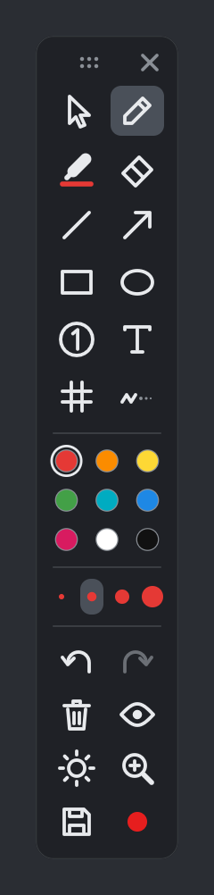

# Instalar e começar

[← Manual](README.md) · [Desenhar →](02-desenhar.md)

## Baixar

- [**Instalar-Rabisco.exe**](https://github.com/neuralcheckpoint/rabisco/releases/latest/download/Instalar-Rabisco.exe): o instalador. É o caminho normal.
- [**rabisco.exe**](https://github.com/neuralcheckpoint/rabisco/releases/latest/download/rabisco.exe): a versão portátil, que roda sem instalar (num pendrive, por exemplo).

Os dois são o mesmo programa, de ~540 KB. Funcionam no Windows 10 e 11.

## Instalar

Dê dois cliques no `Instalar-Rabisco.exe`. Não pede administrador: ele instala só para o seu usuário e:

- copia o programa para `%LOCALAPPDATA%\Programs\Rabisco`;
- cria um atalho no menu Iniciar;
- passa a abrir junto com o Windows, guardado na bandeja;
- aparece em **Configurações > Aplicativos**, para desinstalar;
- abre o Rabisco na hora.

> **"O Windows protegeu o computador"?** Esse aviso aparece com qualquer programa novo sem assinatura digital paga. Clique em **Mais informações → Executar assim mesmo**. Se preferir, compile você mesmo a partir do código ([Por dentro](07-por-dentro.md)).

A versão portátil também instala: rode `rabisco.exe --instalar`.

## A barra

Ao abrir, a barra aparece encostada na esquerda da tela. Arraste pelos pontinhos de cima ou pelo fundo para mudar de lugar. O **✕** guarda a barra na bandeja, sem fechar o Rabisco.

Passe o mouse em cima de um botão para ver o nome e o atalho.

**Dois modos:**
- **Modo desenho:** o mouse (ou a caneta) desenha. Escolher qualquer ferramenta ou cor liga esse modo.
- **Modo mouse:** a seta no topo da barra, ou `Esc`. Os desenhos ficam na tela, mas o clique passa direto para o programa de baixo.

`Ctrl+Shift+D` alterna entre os dois em qualquer programa.

**Barra transparente:** longe do mouse, a barra fica quase invisível e volta ao normal quando o mouse passa em cima. `Ctrl+Shift+B` liga e desliga. Vem ligada.

 

## A bandeja

O ícone do Rabisco fica ao lado do relógio. No Windows 11 ele pode estar escondido na setinha `^`: arraste-o para fora para deixar sempre à vista.

- **Clique:** mostra ou guarda a barra.
- **Botão direito:** desenhar, esconder os desenhos, apagar tudo, print, gravação, **Barra transparente**, **Abrir com o Windows** (liga e desliga) e sair.

Abrir o Rabisco pelo Iniciar com ele já aberto só mostra a barra: ele nunca abre duas vezes.

## Atualizar

Baixe o instalador novo e dê dois cliques. Ele fecha o Rabisco aberto, troca o programa e abre a versão nova. As suas escolhas (barra transparente, modo de gravação, som) ficam.

## Desinstalar

**Configurações > Aplicativos > Rabisco > Desinstalar.** Sai o programa, o atalho e a abertura com o Windows. Os prints e vídeos que você salvou ficam em `Imagens\Rabisco` e `Vídeos\Rabisco`.

## Fechar

`Ctrl+Shift+Q` em qualquer programa, ou **Sair** no menu da bandeja.
