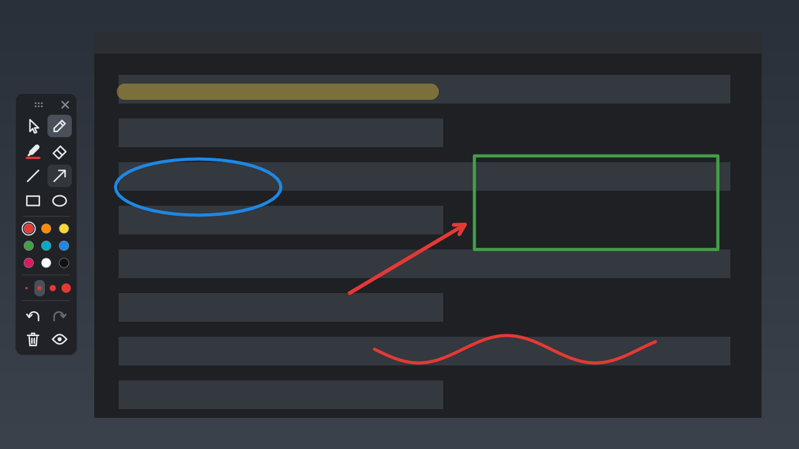

# Manual do Rabisco

O Rabisco desenha por cima de qualquer coisa na tela do Windows: um vídeo, um programa, uma chamada com o cliente. Você risca, mostra, e volta a usar o computador normalmente.

## Páginas

| | Página | O que tem |
|---|---|---|
| 1 | [Instalar e começar](01-comecar.md) | Baixar, instalar, a barra, a bandeja, atualizar e desinstalar |
| 2 | [Desenhar](02-desenhar.md) | Ferramentas, cores, espessura, caneta com pressão, desfazer |
| 3 | [Apresentar e revisar](03-apresentar.md) | Marcadores numerados, texto, fade, guias, holofote e zoom |
| 4 | [Print e vídeo](04-print-e-video.md) | Print da tela ou de uma área, gravação de monitor, janela ou região |
| 5 | [Atalhos](05-atalhos.md) | Todos os atalhos numa página só, para imprimir |
| 6 | [Dúvidas e problemas](06-duvidas.md) | Aviso do Windows, atalho que não funciona, onde ficam os arquivos |
| 7 | [Por dentro](07-por-dentro.md) | Compilar, como o código está dividido e por que ele é leve |

## Em 30 segundos

1. [Baixe o Rabisco.zip](https://github.com/neuralcheckpoint/rabisco/releases/latest/download/Rabisco.zip), extraia e dê dois cliques no `Instalar-Rabisco.exe`.
2. A barra aparece na esquerda da tela. Clique no lápis e desenhe.
3. `Esc` volta ao mouse: os desenhos ficam na tela e o clique passa para o programa de baixo.
4. `Ctrl+Shift+X` apaga tudo. `Ctrl+Shift+S` tira um print com os desenhos.
